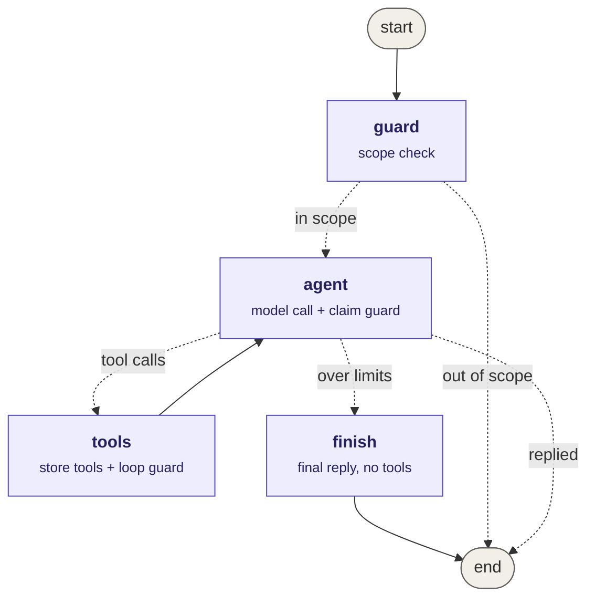

# Assistant graph

Generated by `npm run agent:graph` from `lib/ai/agent.ts`. Don't edit by hand.

Solid arrows always run next. Dotted arrows are a choice the graph makes, labelled with the branch name.

