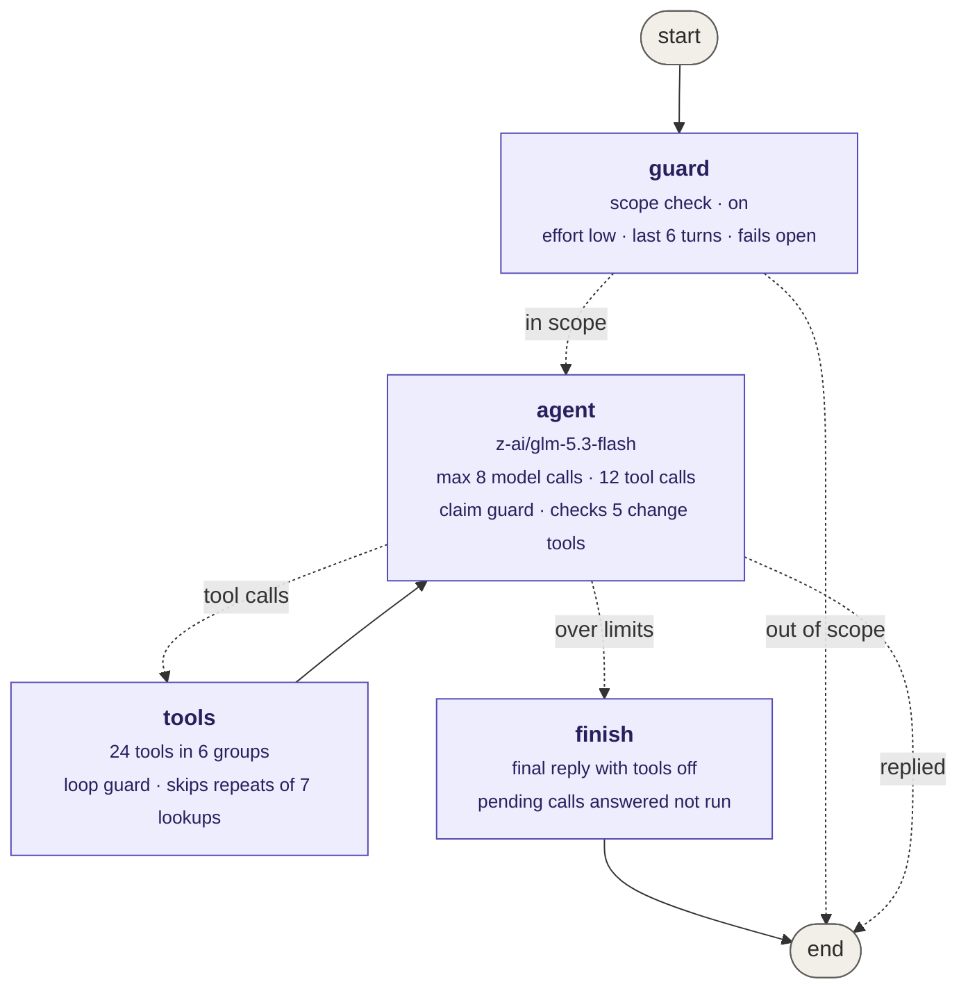

# Assistant graph

Generated by `npm run agent:graph` from `lib/ai/agent.ts`. Don't edit by hand.

Solid arrows always run next. Dotted arrows are a choice the graph makes, labelled with the branch name. The model and limits are read from the config and `.env` when the script runs.

## Tools (24)

| Group | Count | Tools |
| --- | --- | --- |
| skills | 1 | `load_skill` |
| general | 4 | `get_store_info`, `open_page`, `calculate`, `get_current_time` |
| catalog | 6 | `search_products`, `get_product_details`, `list_categories`, `list_subcategories`, `list_brands`, `get_product_reviews` |
| graph | 3 | `find_related_products`, `get_brand_overview`, `get_category_brands` |
| account | 6 | `get_account_status`, `get_my_wishlist`, `add_to_wishlist`, `remove_from_wishlist`, `get_my_orders`, `get_my_addresses` |
| cart | 4 | `view_cart`, `add_to_cart`, `update_cart_quantity`, `remove_from_cart` |

- **Claim guard** checks replies against changes made by: `add_to_cart`, `update_cart_quantity`, `remove_from_cart`, `add_to_wishlist`, `remove_from_wishlist`.
- **Loop guard** skips repeated calls to: `search_products`, `get_product_details`, `list_categories`, `list_subcategories`, `list_brands`, `get_product_reviews`, `get_store_info`.
