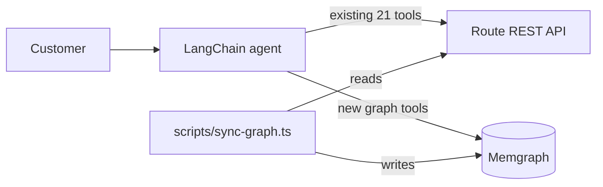
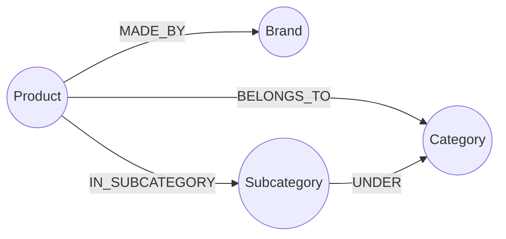

# Nova Store × Memgraph: a hands-on course

This course teaches graph databases, Cypher and Memgraph by building one real feature: a **knowledge graph of the Nova Store catalog** that the LangChain shopping assistant can query for related products and relationship-based recommendations.

Every example uses the store's real data from the Route e-commerce API, so what you learn here is exactly what ships.

> **How to use this course.** Read a lesson, run its queries in Memgraph Lab (http://localhost:3010), then do the exercises. Answers are hidden in collapsible blocks: try first, then check. Lessons 1–7 need only Memgraph Lab. Lessons 8–11 write code in this repo.

---

## Contents

| # | Lesson | You will be able to… |
|---|---|---|
| 0 | [Where we are](#lesson-0--where-we-are) | Explain the project plan and what is done |
| 1 | [Why a graph?](#lesson-1--why-a-graph) | Decide when a graph beats SQL or plain API calls |
| 2 | [The property graph model](#lesson-2--the-property-graph-model) | Name nodes, labels, relationships and properties |
| 3 | [Memgraph Lab tour](#lesson-3--memgraph-lab-tour) | Run queries and read the graph view |
| 4 | [Cypher: reading data](#lesson-4--cypher-reading-data) | Write `MATCH`, `WHERE`, `RETURN`, aggregations, `WITH` |
| 5 | [Cypher: writing data](#lesson-5--cypher-writing-data) | Use `CREATE`, `MERGE`, `SET`, `DELETE` safely |
| 6 | [Designing the Nova schema](#lesson-6--designing-the-nova-schema) | Justify every node, edge and property we store |
| 7 | [Constraints, indexes and query plans](#lesson-7--constraints-indexes-and-query-plans) | Make lookups fast and prove it with `PROFILE` |
| 8 | [Talking to Memgraph from TypeScript](#lesson-8--talking-to-memgraph-from-typescript) | Connect with the Bolt driver and avoid its traps |
| 9 | [The ingestion script](#lesson-9--the-ingestion-script) | Load the whole catalog with batched, repeatable writes |
| 10 | [Graph tools for the agent](#lesson-10--graph-tools-for-the-agent) | Wrap Cypher in LangChain tools |
| 11 | [How the agent picks a tool](#lesson-11--how-the-agent-picks-a-tool) | Steer the model between REST and graph tools |
| 12 | [GraphRAG vs graph queries vs vector RAG](#lesson-12--graphrag-vs-graph-queries-vs-vector-rag) | Place this project on the map of retrieval methods |
| 13 | [Production concerns](#lesson-13--production-concerns) | Plan hosting, sync, safety and performance |
| A | [Cypher cheat sheet](#appendix-a--cypher-cheat-sheet) | Quick reference |
| B | [Troubleshooting](#appendix-b--troubleshooting) | Fix common errors |
| C | [Glossary](#appendix-c--glossary) | Look up terms |
| D | [Running Memgraph with Docker](#appendix-d--running-memgraph-with-docker) | Run, configure, back up and upgrade the database |

---

## Lesson 0 — Where we are

### The goal

The assistant already has 21 REST-backed tools (search, product details, cart, wishlist, orders…). They answer *"what is this product?"* well. They answer *"what is this product connected to?"* poorly: finding related items means loading every product and filtering in JavaScript.

We add a graph that holds the **catalog's structure**, and a few new tools that query it. Existing tools stay exactly as they are.

### Architecture



**Division of responsibility:**

| Source of truth | Owns |
|---|---|
| Route REST API | Live prices, stock, cart, orders, accounts, wishlist, reviews: anything that changes per minute or per user |
| Memgraph | Relationships: product → brand, product → category, product → subcategory, subcategory → category |

The graph also stores *snapshots* of price, rating, stock and sold, so it can filter and rank ("in stock, under 500 EGP, most sold first"). Before quoting a price to a customer, the agent still calls `get_product_details`, which hits the live API.

### Progress

- [x] Next.js store, LangChain agent, 21 tools, 3 skills
- [x] Memgraph running in Docker. It was first set up with the discontinued `memgraph/memgraph-platform` image (Memgraph 2.14.1, from February 2024) and moved to Docker Compose with Memgraph 3.14 and Lab on port 3010 ([Appendix D](#appendix-d--running-memgraph-with-docker))
- [x] Inspected the real API responses (findings in [Lesson 6](#lesson-6--designing-the-nova-schema))
- [x] Split `lib/api.ts` so a plain Node script can reuse it: `lib/store-api.ts` ([Lesson 9](#lesson-9--the-ingestion-script))
- [x] Write `scripts/sync-graph.ts` and load the graph with `npm run graph:sync`
- [x] Add graph tools to the agent: `find_related_products`, `get_brand_overview`, `get_category_brands` ([Lesson 10](#lesson-10--graph-tools-for-the-agent))
- [x] Update the system prompt so the agent knows when to use them ([Lesson 11](#lesson-11--how-the-agent-picks-a-tool))
- [x] Tested end to end through `/api/chat` with real questions

---

## Lesson 1 — Why a graph?

### The core idea

A relational database stores **things** in tables and works out how they connect **at query time**, by matching foreign keys in a `JOIN`.

A graph database stores the **connections themselves** as first-class records. Each node keeps direct pointers to its neighbours, so following a connection is a pointer hop, not a lookup. This is called *index-free adjacency*.

### The same question, two ways

*"Show in-stock products in the same subcategory as the Woman Shawl, preferring the same brand."*

SQL (imagining the catalog in Postgres):

```sql
SELECT o.id, o.title, (o.brand_id = p.brand_id) AS same_brand
FROM products p
JOIN product_subcategories ps  ON ps.product_id = p.id
JOIN product_subcategories ops ON ops.subcategory_id = ps.subcategory_id
JOIN products o                ON o.id = ops.product_id AND o.id <> p.id
WHERE p.id = '6428ebc6dc1175abc65ca0b9' AND o.stock > 0
ORDER BY same_brand DESC, o.sold DESC
LIMIT 5;
```

Cypher:

```cypher
MATCH (p:Product {id: "6428ebc6dc1175abc65ca0b9"})-[:IN_SUBCATEGORY]->(:Subcategory)<-[:IN_SUBCATEGORY]-(o:Product)
WHERE o.stock > 0
OPTIONAL MATCH (o)-[:MADE_BY]->(shared:Brand)<-[:MADE_BY]-(p)
RETURN o.id, o.title, shared IS NOT NULL AS sameBrand
ORDER BY sameBrand DESC, o.sold DESC
LIMIT 5;
```

The Cypher reads like the sentence it answers. With every extra hop ("…and products from brands that also sell in that category…"), SQL gains another two `JOIN`s while Cypher gains one more arrow.

### When a graph helps

- Questions are about **connections**: related, similar, also, shared, path, neighbourhood
- You need **several hops**, or a varying number of hops
- The shape of the data keeps growing new kinds of relationships

### When it doesn't

- Simple lookups by id, totals, reports over one table: SQL or the API is fine
- High-volume transactional writes (orders, payments): keep them in the transactional system
- Data with no meaningful connections

That is why we **don't** move carts, orders or accounts into Memgraph.

### Why Memgraph specifically

Memgraph is an **in-memory** graph database that speaks **Cypher** (the same language as Neo4j) over the **Bolt** protocol. Being in-memory makes it fast for traversals. It writes snapshots and a write-ahead log to disk so data survives restarts. Because it speaks Bolt, the official `neo4j-driver` npm package works with it.

---

## Lesson 2 — The property graph model

There are only four building blocks.

| Concept | What it is | Nova example |
|---|---|---|
| **Node** | A thing | The Woman Shawl |
| **Label** | A node's type. A node can have several. | `:Product` |
| **Relationship** | A typed, directed connection between two nodes | `MADE_BY` |
| **Property** | A key–value pair on a node *or* a relationship | `price: 149` |

### Drawing it

Cypher writes graphs as ASCII art. Round brackets are nodes, arrows are relationships:

```
(:Product {title: "Woman Shawl"})-[:MADE_BY]->(:Brand {name: "DeFacto"})
```

### Our schema



| Label | Properties |
|---|---|
| `Product` | `id`, `title`, `slug`, `price`, `salePrice`, `rating`, `ratingsCount`, `stock`, `sold`, `syncedAt` |
| `Brand` | `id`, `name`, `slug`, `syncedAt` |
| `Category` | `id`, `name`, `slug`, `syncedAt` |
| `Subcategory` | `id`, `name`, `slug`, `syncedAt` |

`id` is always the API's `_id`, e.g. `6428ebc6dc1175abc65ca0b9`. That is the same id the existing `get_product_details` tool takes, so graph results plug straight into the REST tools.

### Naming conventions

These are conventions, not rules, but everyone follows them:

- Labels: `PascalCase`, singular: `Product`, not `products`
- Relationship types: `UPPER_SNAKE_CASE`, a verb phrase read along the arrow: `(Product)-[:MADE_BY]->(Brand)`
- Properties: `camelCase`

### Direction

Every stored relationship has one direction. Pick the direction that reads naturally ("product MADE_BY brand"). You can still **query** in either direction, or ignore direction with `-[:MADE_BY]-`. Never store the same fact twice in both directions.

### Exercise 2.1

In the drawing `(a:Product)-[:IN_SUBCATEGORY]->(s:Subcategory)-[:UNDER]->(c:Category)`, how many nodes, relationships and variables are there?

<details><summary>Answer</summary>

3 nodes, 2 relationships, 3 variables (`a`, `s`, `c`). The relationships have no variables because we didn't name them. Writing `-[r:UNDER]->` would add a fourth.
</details>

---

## Lesson 3 — Memgraph Lab tour

### Start Memgraph

Memgraph and Lab run from [`docker-compose.yml`](../../docker-compose.yml) in the repo root. [Appendix D](#appendix-d--running-memgraph-with-docker) explains every line.

```powershell
npm run graph:up
```

It waits until the database passes its health check. Then see what's running:

```powershell
docker compose ps
```

You should see `nova-memgraph` as `healthy` and `nova-memgraph-lab` as `running`. Because they're set to `restart: unless-stopped`, they also come back by themselves after a reboot.

### Using Lab

1. Open http://localhost:3010. Lab is on 3010 so `next dev` can keep port 3000. It's pre-configured to connect to the database, so just click **Connect**.
2. Go to **Query execution**.
3. Type a query and press **Run** (or `Ctrl+Enter`).
4. Switch the result between **Graph** (nodes and arrows) and **Data** (a table).

Lab can run several statements in one go if you end each with `;`.

### Your first queries

```cypher
RETURN "hello graph" AS greeting;
```

```cypher
SHOW STORAGE INFO;
```

That shows node count, edge count and memory use. Run it before and after loading data.

```cypher
MATCH (n) RETURN count(n);
```

It should return `0` for now.

---

## Lesson 4 — Cypher: reading data

### Setup: a practice graph

Paste this into Lab and run it. It builds a small graph with the real Woman Shawl plus a few made-up practice products. Don't worry about understanding `MERGE` yet: that's Lesson 5. We'll wipe this graph before loading the real catalog.

```cypher
MERGE (wf:Category {id: "6439d58a0049ad0b52b9003f"}) SET wf.name = "Women's Fashion";
MERGE (mf:Category {id: "practice-cat-men"}) SET mf.name = "Men's Fashion";
MERGE (bk:Category {id: "practice-cat-books"}) SET bk.name = "Books";

MERGE (wc:Subcategory {id: "6407f1bcb575d3b90bf95797"}) SET wc.name = "Women's Clothing";
MERGE (mc:Subcategory {id: "practice-sub-men"}) SET mc.name = "Men's Clothing";

MERGE (d:Brand {id: "64089bbe24b25627a253158b"}) SET d.name = "DeFacto";
MERGE (x:Brand {id: "practice-brand-x"}) SET x.name = "BrandX";

MERGE (p:Product {id: "6428ebc6dc1175abc65ca0b9"}) SET p.title = "Woman Shawl",   p.price = 149, p.salePrice = 149, p.rating = 4.1, p.stock = 220, p.sold = 3948;
MERGE (p:Product {id: "practice-p1"})              SET p.title = "Practice Scarf", p.price = 199, p.salePrice = 159, p.rating = 4.5, p.stock = 10,  p.sold = 500;
MERGE (p:Product {id: "practice-p2"})              SET p.title = "Practice Dress", p.price = 899, p.salePrice = 899, p.rating = 3.9, p.stock = 0,   p.sold = 900;
MERGE (p:Product {id: "practice-p3"})              SET p.title = "Practice Shirt", p.price = 350, p.salePrice = 350, p.rating = 4.8, p.stock = 40,  p.sold = 1200;

MATCH (s:Subcategory {id: "6407f1bcb575d3b90bf95797"}), (c:Category {id: "6439d58a0049ad0b52b9003f"}) MERGE (s)-[:UNDER]->(c);
MATCH (s:Subcategory {id: "practice-sub-men"}), (c:Category {id: "practice-cat-men"}) MERGE (s)-[:UNDER]->(c);

MATCH (p:Product), (s:Subcategory {id: "6407f1bcb575d3b90bf95797"}), (c:Category {id: "6439d58a0049ad0b52b9003f"})
WHERE p.id IN ["6428ebc6dc1175abc65ca0b9", "practice-p1", "practice-p2"]
MERGE (p)-[:IN_SUBCATEGORY]->(s) MERGE (p)-[:BELONGS_TO]->(c);

MATCH (p:Product {id: "practice-p3"}), (s:Subcategory {id: "practice-sub-men"}), (c:Category {id: "practice-cat-men"})
MERGE (p)-[:IN_SUBCATEGORY]->(s) MERGE (p)-[:BELONGS_TO]->(c);

MATCH (p:Product), (b:Brand {id: "64089bbe24b25627a253158b"})
WHERE p.id IN ["6428ebc6dc1175abc65ca0b9", "practice-p1", "practice-p3"]
MERGE (p)-[:MADE_BY]->(b);

MATCH (p:Product {id: "practice-p2"}), (b:Brand {id: "practice-brand-x"}) MERGE (p)-[:MADE_BY]->(b);
```

Look at it:

```cypher
MATCH (n)-[r]->(m) RETURN n, r, m;
```

You should see 4 products, 2 brands, 3 categories (Books has nothing attached) and 2 subcategories.

### 4.1 `MATCH` and `RETURN`

`MATCH` describes a pattern. Memgraph finds **every** place in the graph where it fits, and each fit becomes one row.

```cypher
MATCH (p:Product)
RETURN p.title, p.salePrice;
```

```cypher
MATCH (p:Product)-[:MADE_BY]->(b:Brand)
RETURN p.title, b.name;
```

You can return whole nodes (`RETURN p`, which Lab draws in Graph view) or individual properties (`RETURN p.title`, a table).

**Inline property filters** are shorthand for equality:

```cypher
MATCH (b:Brand {name: "DeFacto"})<-[:MADE_BY]-(p:Product)
RETURN p.title;
```

Notice that the arrow points left here. Direction is about how the data was stored, not about the order you write things in.

### 4.2 `WHERE`

```cypher
MATCH (p:Product)
WHERE p.stock > 0 AND p.salePrice < 400
RETURN p.title, p.salePrice, p.stock;
```

Useful operators:

| Operator | Example |
|---|---|
| Comparison | `=`, `<>`, `<`, `>=` |
| Boolean | `AND`, `OR`, `NOT`, `XOR` |
| Strings | `STARTS WITH`, `ENDS WITH`, `CONTAINS`, `=~` (regex) |
| Lists | `IN [..]` |
| Nulls | `IS NULL`, `IS NOT NULL` |
| Case-insensitive | `toLower(b.name) = toLower($name)` |

**Pattern conditions.** A `WHERE` can test whether a pattern exists:

```cypher
// Categories with no products
MATCH (c:Category)
WHERE NOT exists((c)<-[:BELONGS_TO]-(:Product))
RETURN c.name;
```

> **Version note:** on Memgraph 3.x, which this project uses, `exists(pattern)` works anywhere, for example `RETURN exists((p)-[:MADE_BY]->()) AS hasBrand`. Memgraph 2.x allowed it only in `WHERE` and failed with *"Exists cannot be used within RETURN!"*. The portable way, which works on every version, is `OPTIONAL MATCH` plus a `null` test. Lesson 4.5 explains `OPTIONAL MATCH`, and exercise 4.6 uses it.

### 4.3 Sorting and paging

```cypher
MATCH (p:Product)
RETURN p.title, p.sold
ORDER BY p.sold DESC
SKIP 0 LIMIT 2;
```

### 4.4 Aggregation: no `GROUP BY`

Cypher groups automatically. **Every non-aggregated column in `RETURN` is the grouping key.**

```cypher
MATCH (p:Product)-[:BELONGS_TO]->(c:Category)
RETURN c.name AS category, count(p) AS products, avg(p.salePrice) AS avgPrice;
```

Here the grouping key is `category`. Common aggregates: `count`, `sum`, `avg`, `min`, `max`, `collect`.

`collect()` gathers values into a **list**. It's the most useful aggregate for AI tools, because it returns one compact row instead of many:

```cypher
MATCH (b:Brand)<-[:MADE_BY]-(p:Product)
RETURN b.name, count(p) AS n, collect(p.title) AS titles;
```

Use `count(DISTINCT x)` or `collect(DISTINCT x)` to remove duplicates.

### 4.5 `OPTIONAL MATCH`: the LEFT JOIN

A normal `MATCH` drops rows that don't fit. `OPTIONAL MATCH` keeps them and fills the missing parts with `null`.

```cypher
// Only categories that have products: Books is missing
MATCH (c:Category)<-[:BELONGS_TO]-(p:Product)
RETURN c.name, count(p);
```

```cypher
// All categories, Books shows 0
MATCH (c:Category)
OPTIONAL MATCH (c)<-[:BELONGS_TO]-(p:Product)
RETURN c.name, count(p);
```

`count(p)` skips nulls, which is why Books shows `0` and not `1`.

### 4.6 `WITH`: chaining query stages

`WITH` works like `RETURN`, except the query keeps going. Use it to filter on an aggregate, which is what SQL calls `HAVING`, or to break a query into steps.

```cypher
// Brands with at least 2 products, then show their best seller
MATCH (b:Brand)<-[:MADE_BY]-(p:Product)
WITH b, count(p) AS n
WHERE n >= 2
MATCH (b)<-[:MADE_BY]-(top:Product)
RETURN b.name, n, top.title, top.sold
ORDER BY top.sold DESC
LIMIT 1;
```

**Important:** after a `WITH`, only the variables you list are still available. Here `p` is gone after line 2, so we match again as `top`.

### 4.7 Multi-hop patterns

```cypher
// Product → subcategory → category, in one pattern
MATCH (p:Product)-[:IN_SUBCATEGORY]->(s:Subcategory)-[:UNDER]->(c:Category)
RETURN p.title, s.name, c.name;
```

```cypher
// Siblings: other products in the same subcategory as the shawl
MATCH (:Product {id: "6428ebc6dc1175abc65ca0b9"})-[:IN_SUBCATEGORY]->(s)<-[:IN_SUBCATEGORY]-(other:Product)
RETURN s.name, other.title;
```

Notice that `s` has no label. Memgraph will accept any node there. Adding labels makes the intent clearer and can help the planner.

**A pattern never matches the same relationship twice in one row.** That's why `other` is never the shawl itself in the sibling query: reaching it again would need the same `IN_SUBCATEGORY` edge a second time.

### 4.8 Variable-length paths

`*min..max` repeats a relationship.

```cypher
// Anything reachable from the shawl in 1 to 2 hops, along any relationship type
MATCH (p:Product {id: "6428ebc6dc1175abc65ca0b9"})-[*1..2]-(n)
RETURN DISTINCT labels(n), n.name, n.title;
```

This is powerful but dangerous on big graphs. The number of paths can explode with each extra hop. Always set an upper bound, and prefer naming the relationship types: `-[:IN_SUBCATEGORY|UNDER*1..2]->`.

### 4.9 Returning shaped data

Map literals let you return JSON-like objects, which is ideal for tool results:

```cypher
MATCH (p:Product)-[:MADE_BY]->(b:Brand)
RETURN {id: p.id, title: p.title, brand: b.name, price: p.salePrice} AS product
LIMIT 3;
```

### 4.10 Parameters

In Lab you can write values directly. From code you **always** use parameters (`$name`):

```cypher
MATCH (p:Product {id: $id}) RETURN p.title;
```

Parameters prevent injection, which matters because an LLM will produce some of the values. They also let Memgraph cache the query plan. In Lab, you set parameters in the query editor's parameters panel. If your Lab version doesn't have one, just type the values in.

### Exercises

**4.1** List every product with its brand name and category name, cheapest first.

<details><summary>Answer</summary>

```cypher
MATCH (b:Brand)<-[:MADE_BY]-(p:Product)-[:BELONGS_TO]->(c:Category)
RETURN p.title, b.name, c.name, p.salePrice
ORDER BY p.salePrice;
```
</details>

**4.2** Which products are on sale, and by what percentage? (`salePrice < price`)

<details><summary>Answer</summary>

```cypher
MATCH (p:Product)
WHERE p.salePrice < p.price
RETURN p.title, p.price, p.salePrice,
       round(100.0 * (p.price - p.salePrice) / p.price) AS percentOff;
```
</details>

**4.3** For each brand, list the categories it sells in, as one list per brand.

<details><summary>Answer</summary>

```cypher
MATCH (b:Brand)<-[:MADE_BY]-(:Product)-[:BELONGS_TO]->(c:Category)
RETURN b.name, collect(DISTINCT c.name) AS categories;
```
</details>

**4.4** Find brands that sell in **both** Women's Fashion and Men's Fashion.

<details><summary>Answer</summary>

```cypher
MATCH (b:Brand)<-[:MADE_BY]-(:Product)-[:BELONGS_TO]->(c:Category)
WITH b, collect(DISTINCT c.name) AS cats
WHERE "Women's Fashion" IN cats AND "Men's Fashion" IN cats
RETURN b.name, cats;
```

On the practice graph, DeFacto qualifies: the Shawl and Scarf are in Women's Fashion and the Practice Shirt is in Men's Fashion.
</details>

**4.5** List categories that have no products.

<details><summary>Answer</summary>

```cypher
MATCH (c:Category)
WHERE NOT exists((c)<-[:BELONGS_TO]-(:Product))
RETURN c.name;
```
</details>

**4.6** Related products for the shawl: same subcategory, in stock, same-brand items first, then best sellers.

<details><summary>Answer</summary>

```cypher
MATCH (p:Product {id: "6428ebc6dc1175abc65ca0b9"})-[:IN_SUBCATEGORY]->(:Subcategory)<-[:IN_SUBCATEGORY]-(o:Product)
WHERE o.stock > 0
OPTIONAL MATCH (o)-[:MADE_BY]->(shared:Brand)<-[:MADE_BY]-(p)
RETURN o.title, shared IS NOT NULL AS sameBrand, o.sold
ORDER BY sameBrand DESC, o.sold DESC;
```

`OPTIONAL MATCH` either finds the shared brand or leaves `shared` as `null`, and `IS NOT NULL` turns that into true or false. The Practice Scarf comes back. The Practice Dress is filtered out because its stock is 0.
</details>

---

## Lesson 5 — Cypher: writing data

### 5.1 `CREATE`: always new

```cypher
CREATE (:Brand {id: "dup-test", name: "Dup"});
CREATE (:Brand {id: "dup-test", name: "Dup"});
MATCH (b:Brand {id: "dup-test"}) RETURN count(b);   // 2: a duplicate!
```

`CREATE` never checks what already exists. Use it only when you *know* the thing is new, for example an event log entry.

Clean up:

```cypher
MATCH (b:Brand {id: "dup-test"}) DELETE b;
```

### 5.2 `MERGE`: match or create

```cypher
MERGE (b:Brand {id: "dup-test"}) SET b.name = "Dup";
MERGE (b:Brand {id: "dup-test"}) SET b.name = "Dup";
MATCH (b:Brand {id: "dup-test"}) RETURN count(b);   // 1
```

`MERGE` makes a write **idempotent**: running it once or ten times leaves the same result. A sync script you can re-run safely depends on this.

### 5.3 What goes inside `MERGE {}`: only the key

```cypher
// ❌ Fragile: if the name changes in the API, this pattern stops matching and creates a second node
MERGE (b:Brand {id: "64089bbe24b25627a253158b", name: "DeFacto"})

// ✅ Match on the identity, then set everything else
MERGE (b:Brand {id: "64089bbe24b25627a253158b"})
SET b.name = "DeFacto"
```

### 5.4 `ON CREATE SET` and `ON MATCH SET`

```cypher
MERGE (b:Brand {id: "64089bbe24b25627a253158b"})
ON CREATE SET b.firstSeen = timestamp()   // only when the node is new
ON MATCH  SET b.lastSeen  = timestamp()   // only when it already existed
SET b.name = "DeFacto";                   // every time
```

In Memgraph, `timestamp()` returns **microseconds** since 1970. JavaScript's `Date.now()` uses milliseconds.

Other `SET` forms:

```cypher
SET p += {price: 149, stock: 220}   // merge a map into the properties (keeps the others)
SET p.oldField = null               // removes a property
SET p:Featured                      // adds a label
REMOVE p:Featured                   // removes a label
```

### 5.5 The `MERGE` pattern trap ⚠️

`MERGE` matches or creates the **whole pattern** as one unit.

```cypher
// ❌ If the shawl and DeFacto both exist but aren't connected yet,
//    the whole pattern counts as missing, and Memgraph creates a NEW product
//    AND a NEW brand AND the relationship.
MERGE (p:Product {id: "6428ebc6dc1175abc65ca0b9"})-[:MADE_BY]->(b:Brand {id: "64089bbe24b25627a253158b"})
```

The safe pattern: merge each node on its own, then merge the relationship between the variables you've already bound.

```cypher
// ✅
MERGE (p:Product {id: "6428ebc6dc1175abc65ca0b9"})
MERGE (b:Brand   {id: "64089bbe24b25627a253158b"})
MERGE (p)-[:MADE_BY]->(b);
```

Once you have a uniqueness constraint (Lesson 7), the ❌ version fails with *"Unable to commit due to unique constraint violation on :Product(id)"* instead of quietly creating a duplicate. That's one more reason to add constraints early.

If the nodes must already exist, use `MATCH` instead of `MERGE` for them. Then a typo in an id creates nothing instead of an empty node:

```cypher
MATCH (p:Product {id: $productId}), (b:Brand {id: $brandId})
MERGE (p)-[:MADE_BY]->(b);
```

### 5.6 A `MATCH` that finds nothing drops the row

This matters a lot in batch writes:

```cypher
UNWIND [{id: "a", brand: "64089bbe24b25627a253158b"}, {id: "b", brand: "no-such-brand"}] AS row
MERGE (p:Product {id: row.id})
WITH p, row
MATCH (b:Brand {id: row.brand})    // row "b" has no brand → that row stops here
MERGE (p)-[:MADE_BY]->(b)
SET p.touched = true;              // never runs for "b"
```

Anything after a failed `MATCH` is skipped for that row. In the ingestion script we put optional links (like brand) in a **separate** query, so a missing brand can't stop a product's category from being written.

Clean up:

```cypher
MATCH (p:Product) WHERE p.id IN ["a", "b"] DETACH DELETE p;
```

### 5.7 `UNWIND`: lists into rows

`UNWIND` turns a list into one row per item. With a parameter, this is how you write **many** items in **one** round trip:

```cypher
UNWIND [
  {id: "practice-p9", title: "Practice Hat",  price: 99},
  {id: "practice-p8", title: "Practice Belt", price: 120}
] AS row
MERGE (p:Product {id: row.id})
SET p.title = row.title, p.price = row.price;
```

From TypeScript it looks like `UNWIND $rows AS row …` with `{ rows: [...] }`.

### 5.8 Deleting

```cypher
MATCH (p:Product {id: "practice-p9"}) DELETE p;          // fails if p has relationships
MATCH (p:Product {id: "practice-p8"}) DETACH DELETE p;   // deletes its relationships too
MATCH (:Product {id: "practice-p1"})-[r:MADE_BY]->() DELETE r;   // delete only a relationship
```

Wipe everything. Use this to reset the practice graph:

```cypher
MATCH (n) DETACH DELETE n;
```

### Exercises

**5.1** Run the practice-graph setup from Lesson 4 a **second** time. How many `Brand` nodes are there? Why?

<details><summary>Answer</summary>

Still 2. Every write in the setup is a `MERGE` keyed on `id`, so the second run matches the existing nodes and relationships and creates nothing.
</details>

**5.2** Connect the Practice Dress to DeFacto *instead of* BrandX: remove the old edge and add the new one.

<details><summary>Answer</summary>

```cypher
MATCH (p:Product {id: "practice-p2"})-[r:MADE_BY]->() DELETE r;
MATCH (p:Product {id: "practice-p2"}), (b:Brand {id: "64089bbe24b25627a253158b"})
MERGE (p)-[:MADE_BY]->(b);
```

The ingestion script uses this same "delete old edges, merge new ones" approach whenever a product's brand or category changes in the API.
</details>

**5.3** Write one `UNWIND` query that upserts these two brands and records when each was first seen: `{id: "b1", name: "One"}` and `{id: "b2", name: "Two"}`.

<details><summary>Answer</summary>

```cypher
UNWIND [{id: "b1", name: "One"}, {id: "b2", name: "Two"}] AS row
MERGE (b:Brand {id: row.id})
ON CREATE SET b.firstSeen = timestamp()
SET b.name = row.name;
```
</details>

---

## Lesson 6 — Designing the Nova schema

Graph modelling is mostly about one question: **what do you want to traverse?** Things you hop through become nodes. Things you only read or filter on become properties.

### What the real API returns

We fetched the live API (findings from November 2026):

| Endpoint | Items | Notes |
|---|---|---|
| `GET /products` | 56 over 2 pages | Each product **embeds** its full `brand`, `category` and `subcategory[]` objects, and each embedded subcategory includes its parent `category` id |
| `GET /categories` | 10 | Only 3 have products: Electronics 23, Men's Fashion 22, Women's Fashion 11 |
| `GET /brands` | 54 over 2 pages | Only 11 have products. Every product has a brand. |
| `GET /subcategories` | 7 | **Incomplete:** products use 8 subcategories, and only *Women's Clothing* appears here |

A trimmed real product:

```json
{
  "_id": "6428ebc6dc1175abc65ca0b9",
  "title": "Woman Shawl",
  "price": 149,
  "quantity": 220,
  "sold": 3948,
  "ratingsAverage": 4.1,
  "ratingsQuantity": 60,
  "category":    { "_id": "6439d58a0049ad0b52b9003f", "name": "Women's Fashion" },
  "brand":       { "_id": "64089bbe24b25627a253158b", "name": "DeFacto" },
  "subcategory": [{ "_id": "6407f1bcb575d3b90bf95797", "name": "Women's Clothing",
                    "category": "6439d58a0049ad0b52b9003f" }]
}
```

Values like `sold` and `ratingsQuantity` change over time. The structure is what matters.

### Decisions and reasons

| Decision | Why |
|---|---|
| **Brand, Category, Subcategory are nodes** | We traverse through them ("other products by this brand", "brands in this category"). As properties, they couldn't be hopped through. |
| **Price, rating, stock, sold are properties** | We filter and sort on them but never travel *through* them. A `Price` node would add hops and nothing else. |
| **Graph `id` = API `_id`** | Graph results go straight into `get_product_details`, `add_to_cart` and `add_to_wishlist` with no mapping table |
| **Subcategories are built from embedded product data** | `/subcategories` misses 7 of the 8 in use. Products carry the complete set. `MERGE` handles the many repeats. |
| **Keep `BELONGS_TO` even though `IN_SUBCATEGORY → UNDER` reaches the category** | It's one hop instead of two, it matches the API's own `product.category`, and it still works if a product someday has no subcategory. We checked: the two paths agree for all 56 products. |
| **Load empty categories and brands** | Lets the agent answer "do you sell books?" with "that category exists but has no products right now" |
| **Price and stock are snapshots** | The graph is synced manually. The live API stays the source of truth for anything quoted to a customer. |
| **Each node gets `syncedAt`** | After a sync, any node with an older `syncedAt` no longer exists in the API and can be removed (Lesson 9) |
| **No invented relationships** | No `FREQUENTLY_BOUGHT_WITH` or `COMPATIBLE_WITH` until we have data that supports them. A recommendation built on made-up edges is worse than none. |
| **Skip `availableColors`, images, description** | Colours are always empty in the data. Images and long text aren't traversed, and `get_product_details` already serves them. |

### Ideas for later

When real data exists to support them:

- `(:Customer)-[:ORDERED]->(:Product)` from order history → "customers who bought this also bought…" This needs a privacy review first.
- `(:Product)-[:SIMILAR_TO {score}]->(:Product)` computed from description embeddings (Lesson 12)
- `(:Customer)-[:WISHLISTED]->(:Product)`

### Exercise 6.1

Someone suggests storing `brandName` as a property on each Product instead of having Brand nodes. Which agent question gets harder?

<details><summary>Answer</summary>

Anything that starts from the brand or walks through it. "Which categories does DeFacto cover?" or "brands similar to DeFacto because they share subcategories" would need a scan of every product followed by string grouping, instead of a hop from one Brand node. A rename would also have to update every product. Duplicating it as a property for display is fine, but the node is what makes traversal possible.
</details>

---

## Lesson 7 — Constraints, indexes and query plans

### Why

`MERGE (p:Product {id: $id})` has to check whether that product exists. Without an index, Memgraph reads **every** Product node to find out. With an index, it jumps straight to the node.

### Creating them (Memgraph syntax)

```cypher
CREATE CONSTRAINT ON (n:Product)     ASSERT n.id IS UNIQUE;
CREATE CONSTRAINT ON (n:Brand)       ASSERT n.id IS UNIQUE;
CREATE CONSTRAINT ON (n:Category)    ASSERT n.id IS UNIQUE;
CREATE CONSTRAINT ON (n:Subcategory) ASSERT n.id IS UNIQUE;

CREATE INDEX ON :Product(id);
CREATE INDEX ON :Brand(id);
CREATE INDEX ON :Category(id);
CREATE INDEX ON :Subcategory(id);
```

> **Memgraph ≠ Neo4j here.** In Neo4j, a uniqueness constraint creates an index for you. In Memgraph it **doesn't**, so you create both. The constraint guarantees correctness: a duplicate id is rejected. The index provides speed.

Running these again when they already exist does nothing and raises no error, so a script can safely run them on every sync.

Inspect them:

```cypher
SHOW INDEX INFO;
SHOW CONSTRAINT INFO;
```

A label-only index (`CREATE INDEX ON :Product;`) speeds up "all products" scans, which helps once there are many labels in the graph.

### Reading query plans

`EXPLAIN` shows the plan without running the query. `PROFILE` runs it and shows how many rows each step handled and how long it took.

```cypher
EXPLAIN MATCH (p:Product {id: "6428ebc6dc1175abc65ca0b9"}) RETURN p;
```

| Operator you see | Meaning |
|---|---|
| `ScanAll` | Reads every node in the database. Bad on a big graph. |
| `ScanAllByLabel` | Reads every node with that label. OK for small labels. |
| `ScanAllByLabelProperties` | Uses the index to jump to exact matches. What you want for id lookups. Memgraph 2.x called it `ScanAllByLabelPropertyValue`. |
| `Expand` | Follows relationships from the current node(s) |

This is the real output from this Memgraph instance (3.14). Plans read **bottom-up**.

Without an index:

```
 * Produce {p}
 * Filter (p :Product), {p.id}
 * ScanAll (p)
 * Once
```

With `CREATE INDEX ON :Product(id)`:

```
 * Produce {p}
 * ScanAllByLabelProperties (p :Product {id})
 * Once
```

Without the index, Memgraph reads every node and filters. With it, the lookup is a single step.

Try it: drop the Product index, run `EXPLAIN` again and compare, then re-create the index.

```cypher
DROP INDEX ON :Product(id);
EXPLAIN MATCH (p:Product {id: "6428ebc6dc1175abc65ca0b9"}) RETURN p;
CREATE INDEX ON :Product(id);
```

### Rules of thumb

1. Index every property you `MERGE` or `MATCH` on to find a **starting** node
2. Start queries from the most selective node (an id beats a category)
3. Put labels on pattern nodes: `(s:Subcategory)` rather than `(s)`
4. Always bound variable-length paths (`*1..3`)
5. `LIMIT` early in a `WITH` when you only need the top few

---

## Lesson 8 — Talking to Memgraph from TypeScript

### The driver

Memgraph speaks Bolt, the same wire protocol Neo4j uses, so we use the official Neo4j JavaScript driver:

```powershell
npm install neo4j-driver
```

```powershell
npm install -D tsx
```

`tsx` runs TypeScript files directly with Node, which we need for the ingestion script.

### Environment variables

Add these to `.env`, the file this project uses. It's git-ignored, and `.env.example` lists the same keys. They're optional locally, because the code defaults to `bolt://localhost:7687` with no auth.

```dotenv
MEMGRAPH_URI=bolt://localhost:7687
MEMGRAPH_USER=
MEMGRAPH_PASSWORD=
```

Local Memgraph has no auth by default, so the user and password stay empty.

### A shared client: `lib/graph/client.ts`

The real file:

```ts
// Memgraph connection for server code (the agent's graph tools). See docs/memgraph/README.md, Lesson 8.
import neo4j, { type Driver } from "neo4j-driver";

export class GraphUnavailableError extends Error {}

/** Local dev falls back to the Docker instance. In production the graph is off unless MEMGRAPH_URI is set. */
function graphUri() {
  return process.env.MEMGRAPH_URI || (process.env.NODE_ENV === "production" ? undefined : "bolt://localhost:7687");
}

let driver: Driver | undefined;

/** One driver per process. It holds a connection pool, so never create one per request. */
function graphDriver(): Driver {
  const uri = graphUri();
  if (!uri) throw new GraphUnavailableError("MEMGRAPH_URI is not set");
  driver ??= neo4j.driver(
    uri,
    neo4j.auth.basic(process.env.MEMGRAPH_USER ?? "", process.env.MEMGRAPH_PASSWORD ?? ""),
    {
      // Plain JS numbers instead of the driver's 64-bit Integer objects.
      disableLosslessIntegers: true,
      // Fail fast when Memgraph is down, so the agent can fall back to search_products.
      // executeRead otherwise retries a lost connection for 30 s before giving up.
      connectionTimeout: 3_000,
      connectionAcquisitionTimeout: 3_000,
      maxTransactionRetryTime: 2_000,
    },
  );
  return driver;
}

/** Run a read query and get one plain object per row. Connection failures become GraphUnavailableError. */
export async function runRead<T = Record<string, unknown>>(
  query: string,
  params: Record<string, unknown> = {},
): Promise<T[]> {
  const session = graphDriver().session({ defaultAccessMode: neo4j.session.READ });
  try {
    const res = await session.executeRead((tx) => tx.run(query, params), { timeout: 5_000 });
    return res.records.map((r) => r.toObject() as T);
  } catch (err) {
    if (err instanceof neo4j.Neo4jError && err.code === "ServiceUnavailable") {
      throw new GraphUnavailableError(err.message);
    }
    throw err;
  } finally {
    await session.close();
  }
}

/** Cypher LIMIT needs a real integer; JS numbers are sent as floats. */
export const int = (n: number) => neo4j.int(Math.trunc(n));
```

Two decisions worth noticing:

- **Local dev needs no config.** With no `MEMGRAPH_URI`, development connects to the Docker instance. Production treats a missing URI as "graph off", so the deployed Vercel site keeps working without Memgraph.
- **Fail fast.** Short timeouts mean that when Memgraph is down, the agent gets `graph_unavailable` in about 3 seconds and moves on to `search_products`.

### Concepts

| Term | What it is |
|---|---|
| **Driver** | Long-lived. Owns the connection pool. Create one per process. |
| **Session** | Short-lived. Borrow one per unit of work, then `close()` it. |
| **Transaction** | `executeRead` / `executeWrite` run your function in a transaction and retry it on temporary errors. `session.run()` is an *auto-commit* transaction. |
| **Record** | One result row. `record.get("title")` or `record.toObject()`. |

### Driver traps ⚠️

**1. Integers come back as objects.** By default, `count(p)` returns `Integer { low: 3, high: 0 }`, not `3`. Either use `disableLosslessIntegers: true` (above) or call `.toNumber()`.

**2. JS numbers are sent as floats.** JavaScript has only one number type, so the driver sends `220` as `220.0`. That's harmless for comparisons, but:
- `LIMIT $limit` needs a real integer. Pass `neo4j.int(limit)`.
- To store integers, convert in Cypher: `SET p.stock = toInteger(row.stock)`.

**3. Schema queries must be auto-commit.** In Memgraph, `CREATE INDEX` and `CREATE CONSTRAINT` can't run inside an explicit or managed transaction. You get *"Index manipulation not allowed in multicommand transactions"*. Run them with `session.run()`.

**4. Close the driver in scripts.** A standalone script won't exit until you `await driver.close()`.

**5. Managed transactions retry for 30 seconds.** `executeRead` and `executeWrite` retry temporary failures, a lost connection included, for up to `maxTransactionRetryTime` (30 s by default). With Memgraph stopped, a tool call took **61.5 s** before failing, so the customer would have been staring at a spinner. Setting `maxTransactionRetryTime: 2_000` plus short connection timeouts brought it to **3.2 s**.

### Quick connection test

`scripts/graph-ping.ts`:

```ts
import neo4j from "neo4j-driver";

const driver = neo4j.driver(process.env.MEMGRAPH_URI ?? "bolt://localhost:7687", neo4j.auth.basic("", ""));
const session = driver.session();
const res = await session.run("RETURN 'pong' AS reply, 1 + 1 AS two");
console.log(res.records[0].toObject());
await session.close();
await driver.close();
```

```powershell
npx tsx scripts/graph-ping.ts
```

Expected output: `{ reply: 'pong', two: Integer { low: 2, high: 0 } }`. The `Integer` here is trap #1 in action: this script doesn't set `disableLosslessIntegers`.

---

## Lesson 9 — The ingestion script

### Step 1: make the API code reusable outside Next.js

`lib/api.ts` uses `"use cache"`, `cacheLife` and `cacheTag` from `next/cache`. Those only work inside a running Next.js app. A plain Node script that imports them fails.

So we split the file without changing the app's behaviour:

```
lib/store-api.ts   plain fetchers (getJSON, getAllPages), no Next imports, usable anywhere
lib/api.ts         imports store-api.ts and adds the Next cache directives on top
```

`lib/store-api.ts`:

```ts
import { API_BASE, type ListResponse } from "./types";

export async function getJSON<T>(path: string): Promise<T> {
  const res = await fetch(`${API_BASE}${path}`);
  if (!res.ok) throw new Error(`API ${res.status} for ${path}`);
  return res.json();
}

/** Every item of a paginated list. The API caps a page at 50, so walk all pages. */
export async function getAllPages<T>(path: string): Promise<T[]> {
  const sep = path.includes("?") ? "&" : "?";
  const first = await getJSON<ListResponse<T>>(`${path}${sep}limit=50&page=1`);
  const rest = await Promise.all(
    Array.from({ length: first.metadata.numberOfPages - 1 }, (_, i) =>
      getJSON<ListResponse<T>>(`${path}${sep}limit=50&page=${i + 2}`),
    ),
  );
  return [first, ...rest].flatMap((r) => r.data);
}
```

`lib/api.ts` keeps its exported functions. They now call `getAllPages` from `./store-api`. One small type fix: in `lib/types.ts`, the subcategory embedded in a product also carries `category: string`, which the graph needs for the `UNDER` edge.

### Step 2: the pipeline

```
fetch  →  transform  →  schema  →  upsert nodes  →  upsert edges  →  remove stale  →  verify
```

1. **Fetch** products, categories and brands. All requests must succeed. If any fails, stop before writing anything.
2. **Transform** the API objects into flat rows: the graph's own shape, not the API's.
3. **Schema:** create constraints and indexes. Ignore "already exists".
4. **Upsert nodes** with `UNWIND $rows … MERGE`, one query per label.
5. **Upsert edges:** first delete each product's old outgoing edges, then `MERGE` the current ones. This keeps edges correct when the API changes a product's brand or category.
6. **Remove stale nodes:** every node written in this run gets `syncedAt = runId`. Anything with an older `syncedAt` has disappeared from the API.
7. **Verify:** print counts.

### Step 3: `scripts/sync-graph.ts`

```ts
/**
 * Rebuild the Memgraph catalog graph from the Route API.
 * Safe to run any number of times: every write is a MERGE.
 *
 *   npm run graph:sync
 */
import neo4j, { type Session } from "neo4j-driver";
import { salePrice } from "../lib/format";
import { getAllPages, getJSON } from "../lib/store-api";
import type { Brand, Category, ListResponse, Product } from "../lib/types";

const driver = neo4j.driver(
  process.env.MEMGRAPH_URI ?? "bolt://localhost:7687",
  neo4j.auth.basic(process.env.MEMGRAPH_USER ?? "", process.env.MEMGRAPH_PASSWORD ?? ""),
  { disableLosslessIntegers: true },
);

const LABELS = ["Product", "Brand", "Category", "Subcategory"] as const;

async function ensureSchema(session: Session) {
  for (const label of LABELS) {
    // Auto-commit (session.run) is required for schema queries in Memgraph.
    // Re-running them when they already exist is a no-op.
    await session.run(`CREATE CONSTRAINT ON (n:${label}) ASSERT n.id IS UNIQUE`);
    await session.run(`CREATE INDEX ON :${label}(id)`);
  }
}

async function main() {
  const runId = new Date().toISOString();

  // 1. Fetch. If anything fails we throw here, before touching the graph.
  const [products, categories, brands] = await Promise.all([
    getAllPages<Product>("/products"),
    getJSON<ListResponse<Category>>("/categories").then((r) => r.data),
    getAllPages<Brand>("/brands"),
  ]);
  console.log(`Fetched ${products.length} products, ${categories.length} categories, ${brands.length} brands`);

  // 2. Transform
  const categoryRows = categories.map((c) => ({ id: c._id, name: c.name, slug: c.slug }));
  const brandRows = brands.map((b) => ({ id: b._id, name: b.name, slug: b.slug }));

  // /subcategories is incomplete, so collect them from the products themselves.
  const subMap = new Map<string, { id: string; name: string; slug: string; categoryId: string }>();
  for (const p of products)
    for (const s of p.subcategory)
      subMap.set(s._id, { id: s._id, name: s.name, slug: s.slug, categoryId: s.category });
  const subcategoryRows = [...subMap.values()];

  const productRows = products.map((p) => ({
    id: p._id,
    title: p.title,
    slug: p.slug,
    price: p.price,
    // Same rule as the storefront: the API sends priceAfterDiscount: 0 for "no discount".
    salePrice: salePrice(p),
    rating: p.ratingsAverage,
    ratingsCount: p.ratingsQuantity,
    stock: p.quantity,
    sold: p.sold,
    brandId: p.brand?._id ?? null,
    categoryId: p.category._id,
    subcategoryIds: p.subcategory.map((s) => s._id),
  }));

  const session = driver.session();
  try {
    // 3. Schema
    await ensureSchema(session);

    // 4. Nodes
    await session.run(
      `UNWIND $rows AS row
       MERGE (c:Category {id: row.id})
       SET c.name = row.name, c.slug = row.slug, c.syncedAt = $runId`,
      { rows: categoryRows, runId },
    );
    await session.run(
      `UNWIND $rows AS row
       MERGE (b:Brand {id: row.id})
       SET b.name = row.name, b.slug = row.slug, b.syncedAt = $runId`,
      { rows: brandRows, runId },
    );
    await session.run(
      `UNWIND $rows AS row
       MERGE (s:Subcategory {id: row.id})
       SET s.name = row.name, s.slug = row.slug, s.syncedAt = $runId
       WITH s, row
       MATCH (c:Category {id: row.categoryId})
       MERGE (s)-[:UNDER]->(c)`,
      { rows: subcategoryRows, runId },
    );
    await session.run(
      `UNWIND $rows AS row
       MERGE (p:Product {id: row.id})
       SET p.title = row.title, p.slug = row.slug,
           p.price = row.price, p.salePrice = row.salePrice,
           p.rating = row.rating, p.ratingsCount = toInteger(row.ratingsCount),
           p.stock = toInteger(row.stock), p.sold = toInteger(row.sold),
           p.syncedAt = $runId`,
      { rows: productRows, runId },
    );

    // 5. Edges: clear each product's old links, then write the current ones.
    await session.run(
      `UNWIND $ids AS id
       MATCH (:Product {id: id})-[r:MADE_BY|BELONGS_TO|IN_SUBCATEGORY]->()
       DELETE r`,
      { ids: productRows.map((r) => r.id) },
    );
    await session.run(
      `UNWIND $rows AS row
       MATCH (p:Product {id: row.id}), (c:Category {id: row.categoryId})
       MERGE (p)-[:BELONGS_TO]->(c)`,
      { rows: productRows },
    );
    // Separate query: a missing brand must not block the category edge (Lesson 5.6).
    await session.run(
      `UNWIND $rows AS row
       WITH row WHERE row.brandId IS NOT NULL
       MATCH (p:Product {id: row.id}), (b:Brand {id: row.brandId})
       MERGE (p)-[:MADE_BY]->(b)`,
      { rows: productRows },
    );
    await session.run(
      `UNWIND $rows AS row
       UNWIND row.subcategoryIds AS subId
       MATCH (p:Product {id: row.id}), (s:Subcategory {id: subId})
       MERGE (p)-[:IN_SUBCATEGORY]->(s)`,
      { rows: productRows },
    );

    // 6. Stale nodes: anything this run didn't touch is gone from the API.
    //    `IS NULL` matters: null <> $runId is null (not true), so nodes without syncedAt would survive.
    const stale = await session.run(
      `MATCH (n)
       WHERE (n:Product OR n:Brand OR n:Category OR n:Subcategory)
         AND (n.syncedAt IS NULL OR n.syncedAt <> $runId)
       DETACH DELETE n
       RETURN count(*) AS removed`,
      { runId },
    );
    console.log(`Removed ${stale.records[0].get("removed")} stale nodes`);

    // 7. Verify
    const counts = await session.run(
      `MATCH (n) RETURN labels(n)[0] AS label, count(*) AS n ORDER BY label`,
    );
    for (const r of counts.records) console.log(`${r.get("label")}: ${r.get("n")}`);
  } finally {
    await session.close();
    await driver.close();
  }
}

main().catch((err) => {
  console.error(err);
  process.exit(1);
});
```

Add a script to `package.json`:

```json
"graph:sync": "tsx --env-file-if-exists=.env scripts/sync-graph.ts"
```

```powershell
npm run graph:sync
```

### Why each choice

| Choice | Reason |
|---|---|
| Fetch everything first | A half-finished write followed by stale cleanup could delete good data. Failing before writing is safe. |
| One `UNWIND` per label | 56 products means 1 round trip, not 56 |
| Nodes before edges | Edge queries `MATCH` their endpoints, so the endpoints must already exist |
| Delete old edges, then `MERGE` | `MERGE` only adds. Without deleting, a product moved from Brand A to Brand B would be linked to both. |
| `syncedAt = runId` | Makes stale cleanup a single query, with no need to compare lists in JS |
| `IS NULL OR <>` in cleanup | In Cypher, any comparison with `null` gives `null`, and `WHERE null` drops the row. Without `IS NULL`, nodes that never had `syncedAt` would never be cleaned up. |
| `toInteger()` for counts | The driver sends JS numbers as floats (Lesson 8). Store whole numbers as integers. |

### Before your first real sync

Wipe the practice graph so made-up products don't mix with real ones. Stale cleanup would remove them anyway, but starting clean makes the counts easier to check.

```cypher
MATCH (n) DETACH DELETE n;
```

### Verify in Lab

```cypher
MATCH (n) RETURN labels(n)[0] AS label, count(*) ORDER BY label;
```

Actual output of the first real sync, on 28 November 2026. Running it a second time gives exactly the same numbers:

```
Fetched 56 products, 10 categories, 54 brands
Removed 0 stale nodes
  Brand: 54
  Category: 10
  Product: 56
  Subcategory: 8
  -[:BELONGS_TO]->: 56
  -[:IN_SUBCATEGORY]->: 56
  -[:MADE_BY]->: 56
  -[:UNDER]->: 8
```

To test stale cleanup, create a node the API doesn't know about, then sync. The script should report `Removed 1 stale nodes`.

```cypher
CREATE (:Product {id: "ghost", title: "Ghost"});
```

### Something the real data shows

Run the related-products query for the Woman Shawl on the real graph. The top 4 results are **other products also titled "Woman Shawl"**: colour variants listed as separate products. A recommendation tool would mostly suggest the same item again. Lesson 10 needs to handle this, for example by excluding products with the same title or collapsing them into one entry. Query the real data before you design a tool, not just the practice graph.

Querying the real data also caught a bug in the first version of this script. It computed `salePrice` as `p.priceAfterDiscount ?? p.price`, but the API sends `priceAfterDiscount: 0` to mean "no discount", and `??` only falls back on `null` or `undefined`, not `0`. Nine TVs and laptops showed a price of 0. The script now reuses the storefront's own `salePrice()` from `lib/format.ts`. Check this with:

```cypher
MATCH (p:Product) WHERE p.salePrice = 0 OR p.salePrice > p.price RETURN count(p);   // expect 0
```

```cypher
// Every product should have a category and a brand: expect no rows
MATCH (p:Product)
WHERE NOT exists((p)-[:BELONGS_TO]->()) OR NOT exists((p)-[:MADE_BY]->())
RETURN p.title;
```

```cypher
// Edge totals by type: expect 56 of each product edge, 8 UNDER
MATCH ()-[r]->() RETURN type(r), count(*);
```

On Memgraph 3.x you can also count a pattern directly per product. Memgraph 2.x didn't support this `count { }` syntax.

```cypher
MATCH (p:Product)
RETURN count { (p)-[:BELONGS_TO]->() } AS categories, count(*) AS products
ORDER BY categories;
```

```cypher
// Look at the whole graph
MATCH (n)-[r]->(m) RETURN n, r, m;
```

### Exercise 9.1

Run `npm run graph:sync` twice. Do the counts change? What would happen if step 5 used `CREATE` instead of `MERGE` and skipped the delete?

<details><summary>Answer</summary>

The counts don't change, because every write is a `MERGE`. With `CREATE` and no delete, each run would add another `BELONGS_TO`, `MADE_BY` and `IN_SUBCATEGORY` edge per product, so after 3 runs each product would have 3 parallel `MADE_BY` edges and every `count()` over them would be wrong.
</details>

---

## Lesson 10 — Graph tools for the agent

### Design principles

1. **Fixed, parameterized queries.** The tool runs a Cypher query **we** wrote. The model only provides values (an id, a brand name, a limit). That makes the tools predictable, testable and safe. Letting the model write its own Cypher ("Text2Cypher") is covered in Lesson 12.
2. **Return ids.** Every product in a result has its API `_id`, so the agent can follow up with `get_product_details`, `add_to_cart` or `open_page`.
3. **Return shaped, small results.** Use `collect()` and maps, with a limit. The model pays for every token.
4. **Say "snapshot" in the description**, so the model fetches live prices before quoting them.
5. **Degrade gracefully.** If Memgraph is down or not configured (on Vercel, for example), return an error the model can work around, then fall back to `search_products`.
6. **Follow the existing pattern:** `tool()`, a Zod schema, `safely()`, `status()`, `result()` from `lib/ai/tools/shared.ts`.

### The real file: `lib/ai/tools/graph.ts`

The tools were built and tested against the real graph. Three things the real data forced, which the first draft didn't handle:

| Problem found in real data | Fix in the tool |
|---|---|
| 5 products are all titled "Woman Shawl" (colour variants). The first draft recommended the shawl back to the customer. | Skip products with the source's title, and collapse other duplicate titles into one row with `otherListings` |
| Some subcategories hold a single product (Video Games, Cameras…), so "same subcategory" finds nothing | Candidates share a subcategory **or** a brand. Same subcategory scores 2 and same brand 1, so the best matches come first and the brand is the fallback. Each result says `why`. |
| A brand or category with no products came back as a row of `null`s | `collect(CASE WHEN c IS NULL THEN null ELSE {...} END)`. `collect()` skips nulls, so the list is empty. |

The core of `find_related_products`:

```cypher
MATCH (p:Product {id: $id})-[:IN_SUBCATEGORY|MADE_BY]->(hub)<-[:IN_SUBCATEGORY|MADE_BY]-(o:Product)
WHERE o.title <> p.title AND o.stock > 0
WITH o, collect(DISTINCT labels(hub)[0]) AS shared          // ["Subcategory", "Brand"], ["Brand"], …
WITH o, "Subcategory" IN shared AS sameSubcategory, "Brand" IN shared AS sameBrand
WITH o, sameSubcategory, sameBrand,
     (CASE WHEN sameSubcategory THEN 2 ELSE 0 END) + (CASE WHEN sameBrand THEN 1 ELSE 0 END) AS score
ORDER BY score DESC, o.sold DESC
WITH o.title AS title, collect({product: o, score: score, …})[0] AS best, count(*) AS variants   // one row per title
…
```

`hub` has no label on purpose: it matches whatever node is in the middle, a Subcategory or a Brand. `labels(hub)[0]` then tells you which.

The full file:

```ts
/**
 * Graph tools: relationship questions answered by the Memgraph catalog graph
 * (filled by `npm run graph:sync`, see docs/memgraph/README.md).
 *
 * Every query is fixed and read-only: the model only supplies values.
 * Prices and stock in the graph are a snapshot from the last sync, so results say so.
 */
import { tool } from "langchain";
import { z } from "zod";
import { GraphUnavailableError, int, runRead } from "@/lib/graph/client";
import { result, safely, status, type Runtime } from "./shared";

const SNAPSHOT_NOTE = "Prices are from the last catalog sync. Call get_product_details before quoting a price or stock level.";

const GRAPH_DOWN = result({
  error: "graph_unavailable",
  message: "Relationship search is unavailable right now. Use search_products with the brand or category instead.",
});

/** Like safely(), plus a readable fallback when Memgraph is off or unreachable. */
const graphSafely = (fn: () => Promise<string>) =>
  safely(async () => {
    try {
      return await fn();
    } catch (err) {
      if (err instanceof GraphUnavailableError) return GRAPH_DOWN;
      throw err;
    }
  });

// Candidates share a subcategory or a brand with the product. Same subcategory counts more than same brand.
// Products with the same title (colour variants listed separately) are dropped or collapsed into one row.
const RELATED_PRODUCTS = `
  MATCH (p:Product {id: $id})-[:IN_SUBCATEGORY|MADE_BY]->(hub)<-[:IN_SUBCATEGORY|MADE_BY]-(o:Product)
  WHERE o.title <> p.title AND o.stock > 0
  WITH o, collect(DISTINCT labels(hub)[0]) AS shared
  WITH o, "Subcategory" IN shared AS sameSubcategory, "Brand" IN shared AS sameBrand
  WITH o, sameSubcategory, sameBrand,
       (CASE WHEN sameSubcategory THEN 2 ELSE 0 END) + (CASE WHEN sameBrand THEN 1 ELSE 0 END) AS score
  ORDER BY score DESC, o.sold DESC
  WITH o.title AS title,
       collect({product: o, sameSubcategory: sameSubcategory, sameBrand: sameBrand, score: score})[0] AS best,
       count(*) AS variants
  WITH best, variants, best.product AS o
  OPTIONAL MATCH (o)-[:MADE_BY]->(b:Brand)
  OPTIONAL MATCH (o)-[:IN_SUBCATEGORY]->(s:Subcategory)
  RETURN o.id AS id, o.title AS title, b.name AS brand, s.name AS subcategory,
         o.salePrice AS price, o.rating AS rating, o.sold AS sold,
         best.sameSubcategory AS sameSubcategory, best.sameBrand AS sameBrand, variants
  ORDER BY best.score DESC, o.sold DESC
  LIMIT $limit`;

type RelatedRow = {
  id: string;
  title: string;
  brand: string | null;
  subcategory: string | null;
  price: number;
  rating: number;
  sold: number;
  sameSubcategory: boolean;
  sameBrand: boolean;
  variants: number;
};

export const findRelatedProducts = tool(
  ({ productId, limit }, runtime: Runtime) =>
    graphSafely(async () => {
      status(runtime, "Finding related products…");
      const rows = await runRead<RelatedRow>(RELATED_PRODUCTS, { id: productId, limit: int(limit) });
      if (!rows.length) {
        const [found] = await runRead(`MATCH (p:Product {id: $id}) RETURN p.id AS id`, { id: productId });
        return result(
          found
            ? { related: [], message: "Nothing related is in stock right now." }
            : { error: "not_found", message: "That product isn't in the catalog graph. Find its id with search_products." },
        );
      }
      return result({
        note: SNAPSHOT_NOTE,
        related: rows.map(({ sameSubcategory, sameBrand, variants, ...r }) => ({
          ...r,
          url: `/product/${r.id}`,
          why: sameSubcategory && sameBrand ? "same type and brand" : sameSubcategory ? "same type" : "same brand",
          ...(variants > 1 ? { otherListings: variants - 1 } : {}),
        })),
      });
    }),
  {
    name: "find_related_products",
    description:
      "Products related to one product: same subcategory and/or same brand, in stock, best matches and best sellers first. " +
      "Use for 'similar', 'like this', 'alternatives', 'what else', 'goes with'. Needs a product id: get one from search_products first.",
    schema: z.object({
      productId: z.string().describe("Product id from search_products or get_product_details"),
      limit: z.number().int().min(1).max(10).default(5),
    }),
  },
);

const BRAND_OVERVIEW = `
  MATCH (b:Brand) WHERE toLower(b.name) = toLower($name)
  OPTIONAL MATCH (b)<-[:MADE_BY]-(p:Product)-[:IN_SUBCATEGORY]->(s:Subcategory)-[:UNDER]->(c:Category)
  WITH b, c, s, p ORDER BY p.sold DESC
  WITH b, c, s, count(p) AS products, min(p.salePrice) AS minPrice, max(p.salePrice) AS maxPrice,
       collect({id: p.id, title: p.title}) AS ranked
  RETURN b.name AS brand,
         collect(CASE WHEN c IS NULL THEN null ELSE
           {category: c.name, subcategory: s.name, products: products, minPrice: minPrice, maxPrice: maxPrice, ranked: ranked}
         END) AS coverage`;

type BrandRow = {
  brand: string;
  coverage: {
    category: string;
    subcategory: string;
    products: number;
    minPrice: number;
    maxPrice: number;
    ranked: { id: string; title: string }[];
  }[];
};

/** Best sellers first, one entry per title, at most n. */
const topUnique = (items: { id: string; title: string }[], n: number) =>
  items.filter((x, i) => items.findIndex((y) => y.title === x.title) === i).slice(0, n);

export const getBrandOverview = tool(
  ({ brandName }, runtime: Runtime) =>
    graphSafely(async () => {
      status(runtime, `Looking at ${brandName}…`);
      const [row] = await runRead<BrandRow>(BRAND_OVERVIEW, { name: brandName });
      if (!row) return result({ error: "not_found", message: `No brand named “${brandName}”. list_brands shows them all.` });
      if (!row.coverage.length) return result({ brand: row.brand, coverage: [], message: "This brand has no products in the store right now." });
      return result({
        note: SNAPSHOT_NOTE,
        brand: row.brand,
        coverage: row.coverage
          .sort((a, b) => b.products - a.products)
          .map(({ ranked, ...c }) => ({
            ...c,
            bestSellers: topUnique(ranked, 3).map((p) => ({ ...p, url: `/product/${p.id}` })),
          })),
      });
    }),
  {
    name: "get_brand_overview",
    description:
      "What one brand sells here: each category and subcategory it covers, with product counts, price range and best sellers. " +
      "Use for 'what does <brand> sell', 'does <brand> make <type>', 'tell me about <brand>'.",
    schema: z.object({ brandName: z.string().describe("Brand name, e.g. DeFacto. Case doesn't matter.") }),
  },
);

const CATEGORY_BRANDS = `
  MATCH (c:Category) WHERE toLower(c.name) CONTAINS toLower($category)
  OPTIONAL MATCH (c)<-[:BELONGS_TO]-(p:Product)-[:MADE_BY]->(b:Brand)
  OPTIONAL MATCH (p)-[:IN_SUBCATEGORY]->(s:Subcategory)
  WITH c, b, count(DISTINCT p) AS products, avg(p.rating) AS avgRating,
       min(p.salePrice) AS minPrice, max(p.salePrice) AS maxPrice, collect(DISTINCT s.name) AS subcategories
  ORDER BY products DESC
  RETURN c.name AS category,
         collect(CASE WHEN b IS NULL THEN null ELSE
           {brand: b.name, products: products, avgRating: round(avgRating * 10) / 10.0,
            minPrice: minPrice, maxPrice: maxPrice, subcategories: subcategories}
         END) AS brands`;

export const getCategoryBrands = tool(
  ({ category }, runtime: Runtime) =>
    graphSafely(async () => {
      status(runtime, "Comparing brands…");
      const rows = await runRead(CATEGORY_BRANDS, { category });
      if (!rows.length) return result({ error: "not_found", message: `No category matching “${category}”. list_categories shows them all.` });
      return result({ note: SNAPSHOT_NOTE, categories: rows });
    }),
  {
    name: "get_category_brands",
    description:
      "Brands that sell in a category, with product counts, average rating, price range and the subcategories each covers. " +
      "Use to compare brands or suggest one ('which brands sell electronics?', 'best brand for men's clothes').",
    schema: z.object({ category: z.string().describe("Category name or part of it, e.g. Electronics, Men's Fashion") }),
  },
);

export const graphTools = [findRelatedProducts, getBrandOverview, getCategoryBrands];
```

They're registered in `lib/ai/tools/index.ts` as `...graphTools`, right after the catalog tools, and documented in `lib/ai/TOOLS.md`.

### Tested results

Run directly against the real graph:

| Call | Result |
|---|---|
| `find_related_products` for the Woman Shawl | Cardigan, tunic, blouse: all DeFacto Women's Clothing, no shawls, `why: "same type and brand"` |
| `find_related_products` for the PS5 charging station (alone in Video Games) | Samsung TVs and monitor, `why: "same brand"` |
| `find_related_products` with a bad id | `not_found`, telling the model to use search_products |
| `get_brand_overview("defacto")` | Women's Fashion / Women's Clothing, 11 products, EGP 149–449, 3 best sellers with one shawl |
| `get_brand_overview("Nike")` | Exists, no products right now |
| `get_category_brands("books")` | Category exists, empty brand list |
| Memgraph unreachable | `graph_unavailable` after 3.2 s. It was 61.5 s before capping retries (Lesson 8 trap #5). |
| Production, `MEMGRAPH_URI` unset | `graph_unavailable` instantly |

Through the real chat API, *"Show me something similar to the Woman Shawl"* produced the stream `Searching for "Woman Shawl"…` → `Finding related products…` → `Looking up the product…` ×2 → a reply listing the cardigan, tunic, blouse and joggers with live prices.

### Test each query in Lab first

Before wiring a query into a tool, run it in Lab with real values. If it's wrong in Lab, it's wrong in the tool, and Lab errors are far easier to read.

### Exercise 10.1

Design a fourth tool, `find_brand_alternatives`: given a brand, return other brands that sell in the **same subcategories**, ranked by how many subcategories they share. Write the Cypher.

<details><summary>Answer</summary>

```cypher
MATCH (b:Brand) WHERE toLower(b.name) = toLower($name)
MATCH (b)<-[:MADE_BY]-(:Product)-[:IN_SUBCATEGORY]->(s:Subcategory)<-[:IN_SUBCATEGORY]-(:Product)-[:MADE_BY]->(alt:Brand)
WHERE alt <> b
RETURN alt.name AS brand, count(DISTINCT s) AS sharedSubcategories, collect(DISTINCT s.name) AS subcategories
ORDER BY sharedSubcategories DESC
LIMIT 5;
```

This is 4 hops. In SQL it would be about 6 joins. This is the kind of question graphs are built for.
</details>

---

## Lesson 11 — How the agent picks a tool

The model chooses tools only from what it can **read**: each tool's `name`, `description` and schema, plus the system prompt. Nothing else.

### Levers, strongest first

1. **Tool descriptions.** Say *when* to use the tool with trigger words ("similar", "related", "alternatives"), and what it **needs** ("a product id from search_products").
2. **A short routing section in `SYSTEM_PROMPT`.** These two lines were added to the `# Tools` section of `lib/ai/prompt.ts`:

   ```
   - For connections between products, use the graph tools: find_related_products for "similar", "like this" or
     "alternatives" (get the product id from search_products first), get_brand_overview for what a brand sells,
     get_category_brands to compare or suggest brands in a category. Use search_products for finding products
     by words, price or filters.
   - Graph tool prices come from the last catalog sync. Before stating a price or stock level for a product you
     recommend, check it with get_product_details. If a graph tool returns graph_unavailable, use search_products
     with the brand or category instead, and don't mention the error.
   ```

3. **Result shapes that lead to the next step.** Returning `id` and the snapshot `note` tells the model what to do next.
4. **Few tools with clear boundaries.** Two tools that sound alike ("search" vs "find") make the model guess. Keep each tool's job distinct.

### Example traces

**"Show me something like the Woman Shawl"**

1. `search_products({ query: "woman shawl" })` → id `6428ebc6dc1175abc65ca0b9`
2. `find_related_products({ productId: "6428ebc6…" })` → 5 related items
3. The answer lists them and links each `/product/<id>`

**"What does DeFacto sell? Is the cheapest one in stock?"**

1. `get_brand_overview({ brandName: "DeFacto" })` → subcategories and top sellers
2. `search_products({ brand: "DeFacto", sort: "price_asc", limit: 1 })` → the cheapest, with live stock
3. The answer combines both results

### Checking it in LangSmith

Ask 10–20 realistic questions and look at the traces:

- Did it pick a graph tool when it should have, and *not* when a plain search was enough?
- Did it confirm prices with `get_product_details` before quoting them?
- How many tool calls did each answer use? The limit is 12 per turn.

If the model misroutes, fix the **description** first. Then the prompt. Change code last.

---

## Lesson 12 — GraphRAG vs graph queries vs vector RAG

| | Vector RAG | Graph queries (this project) | GraphRAG |
|---|---|---|---|
| **Retrieves by** | Semantic similarity of text chunks | Exact structure: hand-written traversals | Finding entities, then expanding their graph neighbourhood |
| **Good for** | "Something cozy for winter" (fuzzy meaning) | "Other items in this subcategory by the same brand" | "Explain how X relates to Y" across many documents and entities |
| **Answers are** | Approximate, ranked | Exact, explainable | Context-rich, more complex to build |
| **Fails when** | The answer depends on relationships or counts | The question is fuzzy or uses words not in the data | The graph is sparse or badly extracted |

### Where Nova sits

What we're building is **"graph queries as tools"**: the agent chooses a fixed traversal, and the results go into its context. Some people call this the simplest form of GraphRAG. It's the right first step because it's predictable and cheap.

### Possible next steps, in order of value

1. **Hybrid: vector to find the start, graph to expand.** Embed product titles and descriptions. A fuzzy question ("warm accessories") finds the starting products by similarity, then the graph expands to their subcategory, brand and siblings. Recent Memgraph versions include vector indexes, so both can live in one database.
2. **Similarity edges.** Precompute `(:Product)-[:SIMILAR_TO {score}]->(:Product)` from embeddings during sync. Then "similar" becomes a single hop.
3. **Text2Cypher.** The model writes Cypher from the schema. It's flexible, but it can produce wrong or expensive queries, so it needs a read-only connection, a timeout, a row limit and validation. Only consider it if the fixed tools keep missing real questions.
4. **Graph algorithms.** The `memgraph/memgraph-mage` image includes the **MAGE** algorithm library, for example `CALL pagerank.get()`. On today's catalog, community detection already finds the three departments by itself ([Appendix D](#appendix-d--running-memgraph-with-docker)). It becomes more useful once customer–product edges exist.

---

## Lesson 13 — Production concerns

### Hosting

The deployed site runs on **Vercel**, which **cannot reach `localhost:7687` on your PC**. Options:

- **Memgraph Cloud**, the managed service
- A small VPS or container host running the Memgraph Docker image, with auth enabled and the port firewalled
- Leave graph tools off in production at first: with `MEMGRAPH_URI` unset, the tools return `graph_unavailable` and the agent falls back to search

Set `MEMGRAPH_URI`, `MEMGRAPH_USER` and `MEMGRAPH_PASSWORD` as Vercel environment variables. Use `bolt+s://` for TLS.

### Persistence

Memgraph keeps data in memory and writes snapshots and a write-ahead log to `/var/lib/memgraph`. In `docker-compose.yml` that folder is the named volume `mg_lib`, so the data survives restarts, `docker compose down` and image upgrades. Only `docker compose down -v` deletes it. Since `npm run graph:sync` rebuilds the graph from the API, losing it locally just means running the sync again.

### Keeping the graph fresh

| Stage | How |
|---|---|
| Now | Manual: `npm run graph:sync` |
| Next | Scheduled: Vercel Cron or a GitHub Action calls a protected sync route, for example hourly |
| Later | Event-driven: re-sync one product when the API reports a change (the Route API has no webhooks, so this needs your own backend) |

Prices and stock in the graph are only as fresh as the last sync. That's why tools tell the model to confirm with the live API.

### Safety

- Graph tools are **read-only** and use **fixed queries**. The model never sends raw Cypher.
- `defaultAccessMode: READ` is a routing hint. In Memgraph Community it isn't a permission system. Real read-only users need Memgraph's auth and role features. Fixed queries are the main protection.
- Set limits on every query (`LIMIT $limit` with a capped Zod schema).
- Add a query timeout in production: Memgraph's `--query-execution-timeout-sec` flag, or a timeout on the driver transaction.

### Performance

- Index every lookup property (Lesson 7) and check with `PROFILE`
- Bound every variable-length path
- Keep the graph small: structure, not descriptions or images
- One driver per process (`lib/graph/client.ts`), never one per request
- For 56 products none of this is noticeable. The habits matter when you add customers and orders.

### Observability

- LangSmith already traces tool calls. Graph tool latency shows up there.
- `SHOW STORAGE INFO;` for memory use
- `docker compose logs memgraph` for server errors

---

## Appendix A — Cypher cheat sheet

```cypher
// ── Read ──────────────────────────────────────────────
MATCH (p:Product {id: $id}) RETURN p
MATCH (p:Product)-[:MADE_BY]->(b:Brand) WHERE b.name = $name RETURN p.title
MATCH (a)-[:REL*1..3]->(b)                       // 1 to 3 hops
OPTIONAL MATCH (c)<-[:BELONGS_TO]-(p)            // keep rows with no match
WITH b, count(p) AS n WHERE n > 2                // pipe + HAVING
RETURN DISTINCT x ORDER BY x.sold DESC SKIP 10 LIMIT 5
RETURN {id: p.id, title: p.title} AS item        // map result
WHERE exists((p)-[:MADE_BY]->(:Brand))           // pattern test (also in RETURN/WITH on 3.x)
RETURN count { (p)-[:MADE_BY]->() }               // count a pattern (3.x)
RETURN [x IN list WHERE x > 2]                    // list comprehension (3.x)

// ── Aggregates ────────────────────────────────────────
count(x)  count(DISTINCT x)  sum  avg  min  max  collect(x)  collect(x)[0..3]

// ── Write ─────────────────────────────────────────────
CREATE (n:Label {k: v})
MERGE (n:Label {id: $id}) ON CREATE SET n.created = timestamp() SET n.name = $name
MERGE (a)-[:REL]->(b)                            // a and b already bound!
SET n += $map      SET n.k = null      SET n:Extra      REMOVE n:Extra
DELETE r           DETACH DELETE n
UNWIND $rows AS row MERGE (n:Label {id: row.id}) SET n.name = row.name

// ── Schema (Memgraph) ─────────────────────────────────
CREATE CONSTRAINT ON (n:Label) ASSERT n.id IS UNIQUE
CREATE INDEX ON :Label(id)
DROP INDEX ON :Label(id)
SHOW INDEX INFO      SHOW CONSTRAINT INFO      SHOW STORAGE INFO

// ── Inspect ───────────────────────────────────────────
EXPLAIN <query>      PROFILE <query>
MATCH (n) RETURN labels(n)[0], count(*)
MATCH ()-[r]->() RETURN type(r), count(*)

// ── Functions ─────────────────────────────────────────
toLower toUpper trim  toInteger toFloat toString  coalesce(a, b)  size(list)
labels(n) type(r) id(n) keys(n) properties(n)  round(x)  timestamp()
```

---

## Appendix B — Troubleshooting

| Symptom | Likely cause | Fix |
|---|---|---|
| `ServiceUnavailable` / `ECONNREFUSED`, or tools return `graph_unavailable` | Memgraph isn't running | `npm run graph:up` |
| Lab won't load | Wrong port, or the Lab container is stopped | Lab is at http://localhost:3010, not 3000. Check `docker compose ps`. |
| `port is already allocated` on `graph:up` | Something else, such as the old `memgraph` container, holds 7687 | `docker ps` to find it, then stop it |
| `nova-memgraph` stuck at `unhealthy` | Memgraph failed to start, often a bad flag in `command:` | `docker compose logs memgraph` |
| `count` shows `Integer { low, high }` | Driver's lossless integers | `disableLosslessIntegers: true` or `.toNumber()` |
| `LIMIT` / `SKIP` error about type | A JS number was sent as a float | `neo4j.int(n)` |
| *"Index manipulation not allowed in multicommand transactions"* | Memgraph needs schema changes in auto-commit | Use `session.run()`, not `executeWrite` |
| *"Exists cannot be used within RETURN/WITH"*, *"no viable alternative at input 'count{('"*, *"Not yet implemented: atom expression"* | You're on Memgraph 2.x, which lacks these features | Upgrade (Appendix D), or use `OPTIONAL MATCH` + `IS NOT NULL` and `MATCH` + `count()` |
| *"unique constraint violation"* | A `CREATE` or whole-pattern `MERGE` tried to duplicate an id | Lesson 5.5 |
| Duplicate nodes | `CREATE` instead of `MERGE`, or extra properties inside `MERGE {}`, or the whole-pattern trap | Lesson 5.3–5.5. Add a uniqueness constraint so duplicates fail loudly. |
| A product lost its brand edge after a sync | Brand id not in `/brands` | Check `MATCH (p:Product) WHERE NOT exists((p)-[:MADE_BY]->()) RETURN p` |
| Script hangs after finishing | Driver not closed | `await driver.close()` |
| `Cannot find module 'next/cache'` in a script | It imported `lib/api.ts` | Import `lib/store-api.ts` instead |

Useful PowerShell commands:

```powershell
docker compose ps
```

```powershell
docker compose logs --tail 50 memgraph
```

```powershell
docker compose restart memgraph
```

---

## Appendix C — Glossary

| Term | Meaning |
|---|---|
| **Node** | An entity in the graph (a product, a brand) |
| **Label** | A node's type, e.g. `:Product`. A node can have several. |
| **Relationship / edge** | A typed, directed link between two nodes |
| **Property** | A key–value pair on a node or relationship |
| **Pattern** | ASCII-art description of nodes and relationships that `MATCH` and `MERGE` look for |
| **Traversal / hop** | Following a relationship from one node to the next |
| **Cypher** | The query language used by Memgraph and Neo4j (standardised as openCypher / GQL) |
| **Bolt** | The binary protocol drivers use to talk to Memgraph (port 7687) |
| **Idempotent** | Running it again gives the same result, like `MERGE` |
| **Upsert** | Update if it exists, insert if it doesn't |
| **Index-free adjacency** | Nodes point directly at their neighbours, so a hop doesn't need an index lookup |
| **MAGE** | Memgraph's library of graph algorithms (PageRank, community detection…) |
| **GraphRAG** | Retrieval that uses graph structure to gather context for an LLM |
| **Text2Cypher** | An LLM generating Cypher queries from natural language |

---

## Appendix D — Running Memgraph with Docker

### Why Docker Compose, and what it replaced

This project first ran Memgraph with one `docker run` command and the all-in-one `memgraph/memgraph-platform` image. When we inspected that container (28 November 2026), we found:

| Problem | Effect |
|---|---|
| The image was last published in **February 2024** (Memgraph 2.14.1). The current release is **3.14**, shipped as separate images. | Missing 2.5 years of features. Several "Memgraph limits" in earlier drafts of this course were really 2.14 limits (see the version notes in Lessons 4 and 9). |
| **No volume** | The data lived inside the container, so `docker rm` would delete it |
| **Restart policy `no`** | After a reboot, Memgraph stayed off |
| **Lab on port 3000** | Clashed with `next dev` |
| **6.6 GB image** | Database, Lab and algorithms all in one image |

`docker-compose.yml` fixes all of these, and lives in git so the setup is reproducible: anyone who clones the repo gets the same database with one command.

### The file, line by line

| Setting | What it does |
|---|---|
| `image: memgraph/memgraph-mage:3.14.0` | Memgraph plus **MAGE**, the graph-algorithm library. Pinned to an exact version so an upgrade is a deliberate choice, not a surprise. |
| `container_name: nova-memgraph` | A fixed name for `docker exec nova-memgraph …` |
| `ports: 7687` | Bolt: the driver, sync script and Lab connect here |
| `ports: 7444` | Log stream that Lab shows |
| `command: --query-execution-timeout-sec=10` | Kills any query running longer than 10 s. The default is 600 s. |
| `command: --memory-limit=2048` | Memgraph is in-memory, so cap it at 2 GB instead of 90% of your RAM |
| `command: --telemetry-enabled=false` | Don't send usage stats to Memgraph |
| `command: --storage-snapshot-*`, `--storage-wal-enabled` | Persistence: a full snapshot every 5 min and on shutdown, plus a write-ahead log of every change |
| `volumes: mg_lib:/var/lib/memgraph` | Data, snapshots and WAL live in a **named volume**, outside the container |
| `restart: unless-stopped` | Starts again after a crash or reboot, unless you stopped it yourself |
| `healthcheck` | Every 10 s, runs `RETURN 0;` through `mgconsole`. The container is `healthy` only when it answers queries, not just when the process is up. |
| `lab: ports 3010:3000` | Lab listens on 3000 inside its container, mapped to 3010 on your PC |
| `QUICK_CONNECT_MG_HOST: memgraph` | Inside Compose's network, containers reach each other by **service name**, so Lab connects to `memgraph:7687` |
| `depends_on … service_healthy` | Lab starts only after the database is healthy |

Check that the flags took effect. The `current_value` column is what's running, and `default_value` is what it would be without our flags:

```cypher
SHOW CONFIG;
```

### Everyday commands

| Command | Does |
|---|---|
| `npm run graph:up` | `docker compose up -d --wait`: starts both containers and waits until they're healthy |
| `npm run graph:sync` | Loads the catalog from the Route API |
| `npm run graph:down` | Stops and removes both containers. **The data stays in the volume.** |
| `docker compose ps` | Status and health |
| `docker compose logs -f memgraph` | Follow the database log |
| `docker exec -it nova-memgraph mgconsole` | A Cypher prompt in your terminal, no Lab needed |
| `docker compose down -v` | Removes the containers **and deletes the data volume**. Only for a clean reset. |

### Proving persistence

This was tested during the migration: `npm run graph:down` removed both containers, `npm run graph:up` created brand-new ones, and `MATCH (n) RETURN count(n)` still returned all **128** nodes. Memgraph loaded the latest snapshot from the volume on startup.

What's on disk:

```cypher
SHOW SNAPSHOTS;    // path, time and size of each snapshot (about 50 KiB for this catalog)
CREATE SNAPSHOT;   // take one now, e.g. before an experiment
```

### Backups

This graph can always be rebuilt with `npm run graph:sync`, so backups are optional. Once the graph holds data that exists nowhere else, such as computed similarity edges or customer data, you'll want them.

**Option 1: a Cypher dump.** This is portable and human-readable. It writes `CREATE` statements for every node, edge, index and constraint:

```powershell
"DUMP DATABASE;" | docker exec -i nova-memgraph mgconsole --output-format=cypherl | Out-File -Encoding utf8 graph-backup.cypherl
```

Windows PowerShell 5.1 can write `>` redirects as UTF-16, so `Out-File -Encoding utf8` keeps the file readable by `mgconsole`.

This was tested on the catalog: 315 lines. You restore by replaying the file into an empty database through `mgconsole`. That direction hasn't been tested here.

**Option 2: copy the snapshot files** out of the volume, which is faster for large graphs:

```powershell
docker cp nova-memgraph:/var/lib/memgraph/snapshots ./memgraph-snapshots
```

### Graph algorithms with MAGE

The `memgraph-mage` image includes MAGE: about 40 modules of ready-made graph algorithms, called with `CALL`. List them:

```cypher
CALL mg.procedures() YIELD name RETURN name ORDER BY name;
```

Three that already say something about this catalog:

**PageRank**, the most central nodes:

```cypher
CALL pagerank.get() YIELD node, rank
RETURN labels(node)[0] AS label, coalesce(node.name, node.title) AS name, round(rank * 1000) / 1000 AS rank
ORDER BY rank DESC LIMIT 5;
```

Result: Electronics, Men's Fashion, Women's Fashion, then the Men's Clothing subcategory.

**Community detection**, clusters found with no hints from us:

```cypher
CALL community_detection.get() YIELD node, community_id
WITH community_id, collect(coalesce(node.name, node.title)) AS members
RETURN community_id, size(members) AS size, members[0..4] AS sample
ORDER BY size DESC;
```

It finds the three departments on its own: Electronics (36 nodes), Men's (28), Women's (14). A fourth group of 50 holds the empty categories and brands with no products, which have no edges.

**Brand overlap**, hand-written with list comprehensions, which are new in 3.x. It answers "which brands sell the same kinds of things as Samsung?":

```cypher
MATCH (b:Brand)<-[:MADE_BY]-(:Product)-[:IN_SUBCATEGORY]->(s:Subcategory)
WITH b, collect(DISTINCT s.name) AS subs
WITH collect({b: b.name, subs: subs}) AS all
UNWIND all AS x UNWIND all AS y
WITH x, y WHERE x.b = "Samsung" AND y.b <> x.b
WITH y.b AS other,
     size([s IN x.subs WHERE s IN y.subs]) AS shared,
     size(x.subs) + size(y.subs) - size([s IN x.subs WHERE s IN y.subs]) AS total
WHERE shared > 0
RETURN other, round(100.0 * shared / total) AS overlapPct
ORDER BY overlapPct DESC;
```

Result: Toshiba 50%, SONY 33%. Asked *"I like Samsung, which other brands sell similar kinds of products?"*, the chatbot independently pointed to SONY and Toshiba using its graph tools.

With 56 products these mostly confirm what you can already see. They pay off once there's more structure, for example `(:Customer)-[:ORDERED]->(:Product)` edges, where community detection finds shopper groups and similarity finds "bought together".

### Upgrading Memgraph later

1. Read the release notes for the new version.
2. Take a backup: `CREATE SNAPSHOT;`, or the dump above.
3. Change the tag in `docker-compose.yml`, for example `3.14.0` → `3.15.0`.
4. Run `npm run graph:up`. Compose pulls the new image and recreates only the containers that changed.
5. Run `npm run graph:sync`, and re-run the tool checks from Lesson 10.

For a **major** jump like 2.x → 3.x, start from an empty volume and re-sync, as this project did. That's simpler and safer than relying on old snapshots loading in a new major version.

### Things this setup deliberately doesn't do

| Not done | Why, and when to add it |
|---|---|
| **Authentication** | Local only, and the ports are on your own machine. Before exposing it anywhere, create a user (`CREATE USER nova IDENTIFIED BY '…';`) and set `MEMGRAPH_USER` / `MEMGRAPH_PASSWORD`. |
| **TLS** | Not needed for localhost. Hosted instances should use `bolt+s://`. |
| **Running in production** | Vercel can't run Docker containers. Production needs Memgraph Cloud or a server you run Docker on (Lesson 13). |
